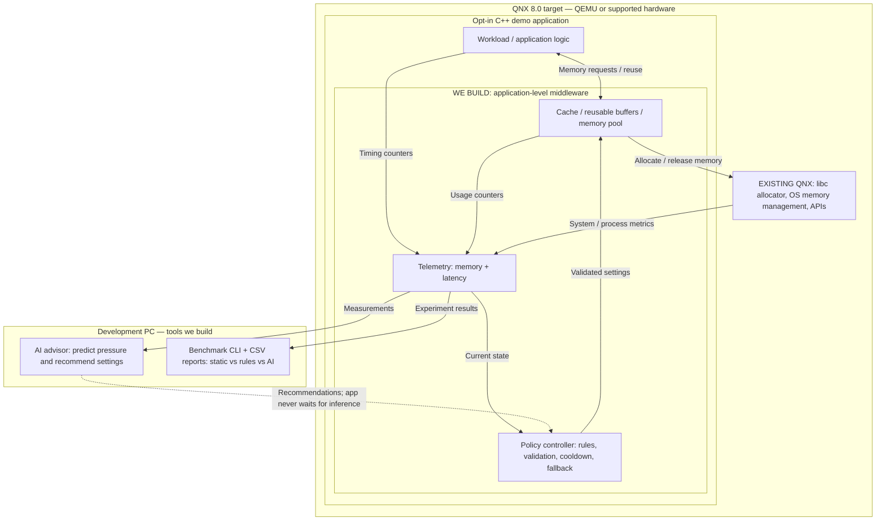

# QNX Control Center

Start the visual dashboard from the project root with PowerShell: `powershell -ExecutionPolicy Bypass -File .\menu.ps1`

To choose between the dashboard and its compiled versions with the same layout (Ratatui and FTXUI), which are built automatically when needed, run `powershell -ExecutionPolicy Bypass -File .\menu-opciones.ps1`.

Setup, guest and host memory telemetry, QEMU/VirtualBox settings, keyboard controls and building the alternative interfaces are documented in [menus/README.md](menus/README.md).

## Repository layout

```text
src/                         QNX target programs (one executable per .cpp)
  probes/memory_probe.cpp    Interactive allocation and memory inspection
  workloads/                Repeatable memory workloads: workload, fm, ramp, step
  examples/                 Hello World and interactive input examples
menus/                      Windows host dashboard and compiled front ends
  ftxui/
    src/                    C++ front-end implementation
    include/                C++ front-end headers
    CMakeLists.txt
  ratatui/src/               Rust front-end implementation
scripts/                    QNX build and VM launch scripts
docs/                       Project planning documents
config/                     Saved configuration assets
menu.ps1                    Main dashboard entry point
menu-opciones.ps1           Interface selector entry point
```

The dashboard discovers runnable QNX programs recursively under `src/`.
The Windows front ends stay under `menus/` so they are not offered as QNX
programs. Headers live with their owning component; there are no shared QNX
headers yet, so a top-level `include/` is not needed. The `src/examples/`
programs are manual examples, not an automated test suite.

Run a target program through the dashboard from the repository root:

```powershell
.\menu.ps1 -Run src\probes\memory_probe.cpp
.\menu.ps1 -Run src\workloads\memory_workload.cpp
```

For the standalone workload VM image, use
`.\scripts\run-memory-workload.cmd` (or add `--build-only` to skip QEMU).
This script expects `qnx800/` and `qnx-hello-vm/` alongside this repository.
Generated builds and recordings remain in the ignored `.build/`,
`menus/bin/`, and `measurements/` directories. Local dashboard settings remain
in the ignored root `qnx.local.json`. `config/imgui.ini` preserves an existing
ImGui layout; the current dashboard front ends do not load it.

## Sprint 3, Step 1: reproducible workload

`src/workloads/memory_workload.cpp` now generates seeded requests and runs a
single-threaded allocate/fill/free baseline. Defaults: seed 42, 1,000 requests,
64 keys, 65,536 bytes per request, and a 10 ms scheduled interval. Eighty percent
of key selections target the first quarter of keys (the remaining selections
cover all keys), providing reuse for the later cache implementation.

From **Windows CMD**, build and start the standalone QNX VM:

```bat
cd /d C:\Users\chaeh\Desktop\Kay\QNX-AI-Adaptive-Memory-Manager
scripts\run-memory-workload.cmd
```

This uses the sibling `qnx800` SDP and `qnx-hello-vm` image, plus QEMU at
`C:\Program Files\qemu\qemu-system-x86_64.exe`. It does not require SSH or
`qnx.local.json`. Wait for the QNX `#` shell prompt, press Enter if startup
messages obscure it, then enter these commands **inside QNX**, one at a time:

```sh
/proc/boot/memory_workload --pattern steady --seed 42 --requests 1000
/proc/boot/memory_workload --pattern burst --seed 42 --requests 1000
/proc/boot/memory_workload --pattern ramp --seed 42 --requests 1000
```

Default runs take roughly 10, 16, and 5.5 seconds respectively, plus any workload
or VM scheduling delay. Each reports its configuration, `sequence_hash`,
completed requests, allocations, result checksum, and elapsed time. Repeat the
same command: its sequence hash and result checksum should match; elapsed time
need not match. `--help` lists all options. Exit QEMU with **Ctrl+A, then X**.

Patterns change the planned arrival spacing, not allocation size:

- `steady`: constant interval.
- `burst`: in each group of 100 requests, the first 20 gaps use interval/10;
  the remaining 80 gaps use interval*2.
- `ramp`: ten phases decrease the interval from 100% to 10%.

The first request is scheduled at time zero. The synchronous baseline waits
until each scheduled time; if processing falls behind, requests run late without
being dropped. This is not a concurrent load generator. `--interval-ms 0`
disables pacing. The baseline allocates one buffer at a time, writes and reads
every byte, then frees it; it does not yet retain a cache or pool.

To inspect reproducible input, run in QNX:

```sh
/proc/boot/memory_workload --seed 42 --requests 20 --trace-only
```

CSV columns are `request_index,key,bytes,scheduled_us`; indices are zero-based,
and `scheduled_us` is the planned offset from the start, not measured latency.
`--trace-only` does not execute the workload. `--trace` executes it and also
prints the CSV. Summaries go to stderr in both modes. To save a trace in QNX:

```sh
/proc/boot/memory_workload --requests 20 --trace-only > /tmp/requests.csv
cat /tmp/requests.csv
```

That file is inside the guest. The standalone VM uses `-snapshot`, so guest
files do not persist after QEMU exits. Trace printing affects execution time;
use runs without `--trace` for comparisons. Runtime statistics and the separate
metrics CSV are described in Step 2 below.

If a running SSH-enabled VM is already configured in `qnx.local.json`, this
alternative **Windows CMD** command builds, uploads, and runs the workload:

```bat
powershell -NoProfile -ExecutionPolicy Bypass -File .\menu.ps1 -Run src\workloads\memory_workload.cpp -RunArgs "--pattern burst --seed 42 --requests 1000"
```

`-RunArgs` accepts simple space-separated tokens, not shell operators, quoted
paths, or redirection; it is supported for direct `-Run`, not `-Prepare`.

For automated verification, run `python scripts\test-memory-workload.py` with
Python 3.10+ on Windows. It compiles with warnings as errors, boots a temporary
QNX test image in headless QEMU, and checks 26 cases covering deterministic
replay, schedules, baseline results, telemetry CSV, reference percentiles,
interruption, and invalid arguments. Build products and the guest log are under
`.build/workload-tests/`.

## Sprint 3, Step 2: runtime telemetry and host CSV

Prerequisite: QNX is running, `qnx.local.json` contains its SSH host/user/port,
and SSH key authentication works without a password prompt. Keep the existing
VM open. This command builds and uploads the current workload, runs it, and
saves a unique CSV directly to the Windows `measurements/` directory:

```powershell
cd "C:\Users\chaeh\Desktop\Kay\QNX-AI-Adaptive-Memory-Manager"
powershell -NoProfile -ExecutionPolicy Bypass -File .\scripts\measure-workload.ps1
```

The same `powershell ...` command works from CMD after changing to the project
directory with `cd /d`. To choose another workload or sample grouping:

```powershell
powershell -NoProfile -ExecutionPolicy Bypass -File .\scripts\measure-workload.ps1 -Pattern burst -Requests 1000 -Seed 42 -SampleEvery 100
```

Other parameters are `-Keys`, `-Bytes`, and `-IntervalMs`. The script prints
`Saved workload metrics: <absolute path>` only after successful execution and
CSV validation. Interrupted/failed runs retain `.csv.partial` output rather
than being presented as successful results. SSH/runtime diagnostics are saved
under `.build/<run-id>.stderr.log`. If the configured SDP script is missing,
the runner checks the sibling `qnx800/qnxsdp-env.bat` installation.

Dashboard program 7 also prints a human-readable p99/throughput/buffer summary
after completion. Its `G` key continues to record the separate system-memory
CSV; it does not activate the new workload CSV. For direct execution in QNX:

```sh
/proc/boot/memory_workload --metrics-csv
```

`--metrics-csv` prints only the telemetry CSV to stdout; diagnostic summaries
go to stderr. `--trace` and `--trace-only` cannot be combined with it.
`--run-id` accepts 1-64 ASCII letters, digits, underscores, or hyphens. The host
runner assigns a UUID-based ID automatically. Direct QNX runs default to an ID
made from the guest wall-clock nanoseconds and PID; a caller can supply an ID
when coordinating records across VM restarts.

### CSV schema version 1 and measurement definitions

Each file contains `window` rows (100 attempted requests each by default, with
a possibly shorter final window) and one `summary` row. Rows are emitted after
execution, so CSV serialization and SSH transfer are outside measured time.
Windows are request-count groups, not fixed time intervals; they become
available at the end of the run rather than streaming live.

| Fields | Meaning |
| --- | --- |
| `schema_version`, `run_id`, `row_type`, `status` | Version, run identity, window/summary, and complete/interrupted/allocation_failed |
| `mode`, `pattern`, `seed`, `configured_requests`, `keys`, `block_bytes`, `interval_ms`, `sample_every` | Reproduction settings; mode is currently baseline |
| `window_index`, `start_ns`, `end_ns` | Zero-based window index (summary uses 0), monotonic offsets from run start in nanoseconds |
| `attempted`, `completed`, `allocation_calls`, `allocations`, `frees`, `allocation_failures` | Counts within this row; summary counts cover the whole run |
| `allocated_bytes` | Sum of successfully requested payload bytes; cumulative allocation volume, not resident RAM |
| `live_buffer_bytes`, `peak_live_buffer_bytes`, `retained_buffer_bytes` | Payload bytes still in use at row boundary, maximum simultaneous live payload in this row, and idle payload retained for reuse |
| `measurement_storage_bytes` | Reserved sample-vector backing storage; excludes statistics scratch vectors, allocator overhead, and other runtime memory |
| `elapsed_seconds`, `throughput_rps` | Observed duration including pacing and in-loop measurement overhead; completed / duration |
| `latency_p50_us`, `latency_p95_us`, `latency_p99_us`, `latency_max_us` | Successful request allocate/fill/read/free service times in microseconds; excludes pacing and request generation |
| `start_lateness_p99_us` | Successful request start minus scheduled start, clamped at zero; separate from service latency |
| `cache_hits`, `cache_misses` | Empty: no cache exists yet; do not interpret as measured zero |
| `sequence_hash`, `result_checksum` | Present on the summary only; allow input/result comparison across repeated runs |

Percentiles use nearest rank: sorted observation at `ceil(p * N)`, counting
from 1. Summary p99 is computed from all successful requests, never averaged
from window p99 values. When no requests succeed, latency fields are empty.
Window durations span the previous window's last completion to the current
window's last completion; the first starts at zero. Overall duration additionally
includes the final loop bookkeeping, so it can slightly exceed summed windows.

The baseline owns one payload buffer at a time. At completion its live and
retained payload bytes are zero, while peak live payload equals `block_bytes`.
These are application-owned counters, **not process RSS, libc heap size, or
QNX total RAM**. Use the dashboard guest/host metrics for those separate views.
Allocation counts exclude measurement and standard-library allocations.

All non-trace-only runs collect timing samples, including the default human
summary mode. Storage grows with configured requests (currently one Sample
struct per request), and sorting uses additional scratch memory after the run.
Measurement overhead is therefore part of the instrumented baseline; this is
not a zero-overhead profiler. `--trace` additionally includes stdout tracing in
overall elapsed time, so do not compare its throughput against non-traced runs.
SIGINT/SIGTERM stop after the current request and output partial statistics with
exit code 130; a hard kill or lost transport may prevent any CSV from arriving.

## Project and plan

**We are building application-level middleware and developer tools that adapt cache and buffer policies in opt-in QNX 8.0 C++ applications and measure the memory–latency tradeoff.**

# QNX Adaptive Memory Manager

Built for the **QNX Global Hackathon**, with AI recommendations outside the real-time execution path.

**Planned category:** Developer Tooling & Host Tools.

## Existing capabilities vs. our contribution

“Existing” below refers to QNX capabilities, not completed features in this repository.

| Area | Already available in QNX | Our planned contribution |
|---|---|---|
| Memory analysis | Momentics Memory Analysis tracks heap allocations and helps detect leaks and corruption. | Collect workload-specific memory and latency metrics for policy decisions and repeatable experiments. |
| Allocation tuning | `mallopt()` exposes allocator controls, including allocation granularity and trimming thresholds. | Implement an opt-in cache/buffer runtime with explicit capacity controls; select and validate policies for that runtime. |
| Adaptive control | The reviewed QNX documentation establishes analysis and tuning primitives, but does not establish an equivalent complete adaptive workflow. | Connect telemetry, threshold rules, and a trained predictor to bounded policy updates, cooldown, and fallback. |
| Evaluation | QNX provides memory analysis and profiling tools. | Compare static, rule-based, and AI-assisted modes on identical workloads, reporting savings, overhead, and regressions. |

Sources: [QNX memory analysis](https://qnx.com/developers/docs/8.0/com.qnx.doc.ide.userguide/topic/analyze_mem_rsc_usage.html) · [QNX allocator controls](https://qnx.com/developers/docs/8.0/com.qnx.doc.neutrino.lib_ref/topic/m/mallopt.html).

**Differentiation to prove:** better memory–latency tradeoffs for a specific QNX workload through an integrated, reproducible control loop. Adaptive caching already has precedents such as [CacheLib](https://cachelib.org/docs/Cache_Library_User_Guides/pool_rebalance_strategy/); we do not claim a first-of-its-kind allocator or guaranteed AI gains.

## Where our middleware fits

The middleware is a library integrated into our demo application, above existing QNX services. It does not replace the QNX memory manager or automatically optimize unrelated applications.



## Core MVP

- **Memory profiling:** Collect system/process memory usage and application counters on QNX.
- **C++ runtime:** Build a bounded cache and reusable buffers or a fixed-block memory pool inside a repeatable demo workload.
- **Policy controller:** Validate changes, enforce limits and cooldown, and fall back safely on invalid input or advisor failure.
- **AI advisor:** Train a lightweight predictor from telemetry to recommend policies on the host or a non-critical background path.
- **CLI and benchmarks:** Compare static, threshold-based, and AI-assisted modes on identical workloads; export CSV results for memory, allocations, p99 latency, throughput, and failures.

Report measured tradeoffs, including regressions or cases where AI does not outperform simple rules. Performance improvements are goals, not demonstrated results.

## Extensions after the MVP

- Native QNX message-passing IPC, a live dashboard, and hot policy reload.
- Additional workloads and a reproducible tutorial.

Application-level optimizations require explicit integration. OS image slimming, kernel changes, DDK drivers, and control of arbitrary third-party processes are outside this MVP. This prototype does not claim hard real-time guarantees.

If the schedule slips, cut the dashboard, advanced AI, then multi-process IPC; preserve QNX execution, the controllable runtime, and reproducible comparisons.

## Development plan

Target **QNX 8.0 on QEMU**, using **QNX SDP 8.0**. Validate the build host and target setup first, including compatibility with the team's Apple Silicon Mac. Exact build/run commands will be added once verified.

Each week has two 3-day sprints and one shared review/buffer day. All dates are in **2026**.

### Shared milestones

| Sprint | Dates | Focus | Completion goal |
|---|---|---|---|
| 1 | Nov 14–16 | Learn QNX basics; set up SDP and QEMU; compile Hello World | Hello World running on QNX, with a saved log |
| 2 | Nov 17–19 | Collect memory metrics; create a repeatable demo workload | Baseline RAM, latency, and throughput report |
| 3 | Nov 21–23 | Implement bounded cache and buffer reuse/pool; measure static vs manual tuning | Tested C++ runtime and initial memory/latency comparison |
| 4 | Nov 24–26 | Add policy validation, threshold rules, hysteresis, cooldown, and fallback | Static vs rule-based demo on QNX |
| 5 | Nov 28–30 | Train a lightweight predictor; validate on separate runs; connect recommendations | AI advisor compared with rules, outside the critical path |
| 6 | Dec 1–3 | Integrate telemetry, runtime, controller, advisor, and CLI; verify reproduction steps | All three modes running on QNX with CSV output; **feature freeze on Dec 3** |
| 7 | Dec 5–7 | Repeat three-mode benchmarks on steady/burst/ramp/mixed loads; test invalid policies and disconnection | Final results, charts, and known limitations |
| 8 | Dec 8–10 | Finish README, license, presentation, and demo video | Submission package ready; public video under 3 minutes |

### Two-person ownership

**Start together (Nov 14–19), then split by specialty.** Both developers establish the QNX environment, minimal workload, telemetry, and interface examples before independent implementation begins.

- **A — C++ middleware / target experiments:** Own cache/buffer management, policy validation and fallback, QNX experiment execution, runtime reliability, build/run documentation, and demo recording.
- **B — AI / host analysis:** Own data preparation, feature design, model training and evaluation, policy recommendations, host-side experiment analysis, and AI/results presentation material. AI is B's core engineering responsibility, not an optional side assignment.
- **Shared:** Interface design, integration, benchmark methodology, result verification, slides, video, and rehearsal. Rebalance supporting tasks at each review to protect B's AI work and avoid overloading A with runtime debugging.

| Sprint / dates | A — middleware and target | B — AI and host tools | Shared completion goal |
|---|---|---|---|
| 1 · Nov 14–16 | Together: QNX setup, boot, and Hello World | Together: same setup, commands, and target evidence | Both can build and run Hello World |
| 2 · Nov 17–19 | Together: minimal workload, telemetry, and baseline run | Together: CSV reader, baseline plot, and interface examples | Working baseline; recorded QNX data, example policies, and agreed formats |
| 3 · Nov 21–23 | Implement bounded cache and buffer reuse/pool; test and export new runs | Build data validation, replay, feature extraction, and training/evaluation pipeline using baseline recordings | Runtime prototype and independently runnable AI pipeline |
| 4 · Nov 24–26 | Add threshold rules, bounds, hysteresis, cooldown, and fallback; test with scripted policies | Develop a first predictor and policy-output adapter; compare offline with threshold rules on available recordings | Rule-based QNX demo and compatible advisor output |
| 5 · Nov 28–30 | Connect advisor files; test stale/invalid recommendations and disconnection; automate QNX runs | Train/refine on new runs; evaluate held-out runs; compare prediction quality and policy outcomes | End-to-end AI demo outside the critical path; initial three-mode comparison |
| 6 · Dec 1–3 | Stabilize runtime and target runner; verify reproduction commands; draft architecture explanation | Stabilize advisor and host reports; document model/data pipeline; draft AI explanation | Integrated static/rules/AI MVP; **feature freeze on Dec 3** |
| 7 · Dec 5–7 | Execute repeated three-mode QNX benchmarks and fault tests; analyze runtime overhead and failures | Analyze memory/latency tradeoffs, prediction errors, and variation; finalize result charts | Jointly verified results and limitations; each owns their analysis section |
| 8 · Dec 8–10 | Finish setup/runtime docs and architecture slides; record QNX demo; assemble video | Finish AI/results docs and slides; prepare chart explanations, narration, and submission summary | Joint slide/script review, video check, and rehearsal; submission package ready |

**Dec 12–14:** Verify public links and submit. **Official deadline: Dec 15, 11:00 a.m. PST.**

Sprint progress map: [QNX Sprint Progress Map](docs/QNX_Sprint_Progress_Map.pdf).

[Hackathon](https://qnx.devpost.com/) · [Rules](https://qnx.devpost.com/rules) · [QNX Everywhere](https://qnx.software/en/developers/get-started/qnx-everywhere)
