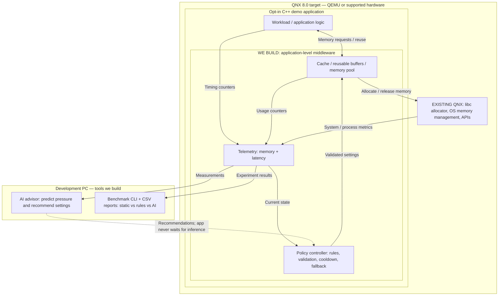

**We are building application-level middleware and developer tools that adapt cache and buffer policies in opt-in QNX 8.0 C++ applications and measure the memory–latency tradeoff.**

# QNX Adaptive Memory Manager

Built for the **QNX Global Hackathon**, with AI recommendations outside the real-time execution path.

**Planned category:** Developer Tooling & Host Tools.

## Existing capabilities vs. our contribution

“Existing” below refers to QNX capabilities, not completed features in this repository.

| Area | Already available in QNX | Our planned contribution |
|---|---|---|
| Memory analysis | Momentics Memory Analysis tracks heap allocations and helps detect leaks and corruption. | Collect workload-specific memory and latency metrics for policy decisions and repeatable experiments. |
| Allocation tuning | `mallopt()` exposes allocator controls, including allocation granularity and trimming thresholds. | Implement an opt-in cache/buffer runtime with explicit capacity controls; select and validate policies for that runtime. |
| Adaptive control | The reviewed QNX documentation establishes analysis and tuning primitives, but does not establish an equivalent complete adaptive workflow. | Connect telemetry, threshold rules, and a trained predictor to bounded policy updates, cooldown, and fallback. |
| Evaluation | QNX provides memory analysis and profiling tools. | Compare static, rule-based, and AI-assisted modes on identical workloads, reporting savings, overhead, and regressions. |

Sources: [QNX memory analysis](https://qnx.com/developers/docs/8.0/com.qnx.doc.ide.userguide/topic/analyze_mem_rsc_usage.html) · [QNX allocator controls](https://qnx.com/developers/docs/8.0/com.qnx.doc.neutrino.lib_ref/topic/m/mallopt.html).

**Differentiation to prove:** better memory–latency tradeoffs for a specific QNX workload through an integrated, reproducible control loop. Adaptive caching already has precedents such as [CacheLib](https://cachelib.org/docs/Cache_Library_User_Guides/pool_rebalance_strategy/); we do not claim a first-of-its-kind allocator or guaranteed AI gains.

## Where our middleware fits

The middleware is a library integrated into our demo application, above existing QNX services. It does not replace the QNX memory manager or automatically optimize unrelated applications.

## Core MVP

- **Memory profiling:** Collect system/process memory usage and application counters on QNX.
- **C++ runtime:** Build a bounded cache and reusable buffers or a fixed-block memory pool inside a repeatable demo workload.
- **Policy controller:** Validate changes, enforce limits and cooldown, and fall back safely on invalid input or advisor failure.
- **AI advisor:** Train a lightweight predictor from telemetry to recommend policies on the host or a non-critical background path.
- **CLI and benchmarks:** Compare static, threshold-based, and AI-assisted modes on identical workloads; export CSV results for memory, allocations, p99 latency, throughput, and failures.

Report measured tradeoffs, including regressions or cases where AI does not outperform simple rules. Performance improvements are goals, not demonstrated results.

## Extensions after the MVP

- Native QNX message-passing IPC, a live dashboard, and hot policy reload.
- Additional workloads and a reproducible tutorial.

Application-level optimizations require explicit integration. OS image slimming, kernel changes, DDK drivers, and control of arbitrary third-party processes are outside this MVP. This prototype does not claim hard real-time guarantees.

If the schedule slips, cut the dashboard, advanced AI, then multi-process IPC; preserve QNX execution, the controllable runtime, and reproducible comparisons.

## Development plan

Target **QNX 8.0 on QEMU**, using **QNX SDP 8.0**. Validate the build host and target setup first, including compatibility with the team's Apple Silicon Mac. Exact build/run commands will be added once verified.

Each week has two 3-day sprints and one shared review/buffer day. All dates are in **2026**.

### Shared milestones

| Sprint | Dates | Focus | Completion goal |
|---|---|---|---|
| 1 | Nov 14–16 | Learn QNX basics; set up SDP and QEMU; compile Hello World | Hello World running on QNX, with a saved log |
| 2 | Nov 17–19 | Collect memory metrics; create a repeatable demo workload | Baseline RAM, latency, and throughput report |
| 3 | Nov 21–23 | Implement bounded cache and buffer reuse/pool; measure static vs manual tuning | Tested C++ runtime and initial memory/latency comparison |
| 4 | Nov 24–26 | Add policy validation, threshold rules, hysteresis, cooldown, and fallback | Static vs rule-based demo on QNX |
| 5 | Nov 28–30 | Train a lightweight predictor; validate on separate runs; connect recommendations | AI advisor compared with rules, outside the critical path |
| 6 | Dec 1–3 | Integrate telemetry, runtime, controller, advisor, and CLI; verify reproduction steps | All three modes running on QNX with CSV output; **feature freeze on Dec 3** |
| 7 | Dec 5–7 | Repeat three-mode benchmarks on steady/burst/ramp/mixed loads; test invalid policies and disconnection | Final results, charts, and known limitations |
| 8 | Dec 8–10 | Finish README, license, presentation, and demo video | Submission package ready; public video under 3 minutes |

### Two-person ownership

**Start together (Nov 14–19), then split by specialty.** Both developers establish the QNX environment, minimal workload, telemetry, and interface examples before independent implementation begins.

- **A — C++ middleware / target experiments:** Own cache/buffer management, policy validation and fallback, QNX experiment execution, runtime reliability, build/run documentation, and demo recording.
- **B — AI / host analysis:** Own data preparation, feature design, model training and evaluation, policy recommendations, host-side experiment analysis, and AI/results presentation material. AI is B's core engineering responsibility, not an optional side assignment.
- **Shared:** Interface design, integration, benchmark methodology, result verification, slides, video, and rehearsal. Rebalance supporting tasks at each review to protect B's AI work and avoid overloading A with runtime debugging.

| Sprint / dates | A — middleware and target | B — AI and host tools | Shared completion goal |
|---|---|---|---|
| 1 · Nov 14–16 | Together: QNX setup, boot, and Hello World | Together: same setup, commands, and target evidence | Both can build and run Hello World |
| 2 · Nov 17–19 | Together: minimal workload, telemetry, and baseline run | Together: CSV reader, baseline plot, and interface examples | Working baseline; recorded QNX data, example policies, and agreed formats |
| 3 · Nov 21–23 | Implement bounded cache and buffer reuse/pool; test and export new runs | Build data validation, replay, feature extraction, and training/evaluation pipeline using baseline recordings | Runtime prototype and independently runnable AI pipeline |
| 4 · Nov 24–26 | Add threshold rules, bounds, hysteresis, cooldown, and fallback; test with scripted policies | Develop a first predictor and policy-output adapter; compare offline with threshold rules on available recordings | Rule-based QNX demo and compatible advisor output |
| 5 · Nov 28–30 | Connect advisor files; test stale/invalid recommendations and disconnection; automate QNX runs | Train/refine on new runs; evaluate held-out runs; compare prediction quality and policy outcomes | End-to-end AI demo outside the critical path; initial three-mode comparison |
| 6 · Dec 1–3 | Stabilize runtime and target runner; verify reproduction commands; draft architecture explanation | Stabilize advisor and host reports; document model/data pipeline; draft AI explanation | Integrated static/rules/AI MVP; **feature freeze on Dec 3** |
| 7 · Dec 5–7 | Execute repeated three-mode QNX benchmarks and fault tests; analyze runtime overhead and failures | Analyze memory/latency tradeoffs, prediction errors, and variation; finalize result charts | Jointly verified results and limitations; each owns their analysis section |
| 8 · Dec 8–10 | Finish setup/runtime docs and architecture slides; record QNX demo; assemble video | Finish AI/results docs and slides; prepare chart explanations, narration, and submission summary | Joint slide/script review, video check, and rehearsal; submission package ready |

**Dec 12–14:** Verify public links and submit. **Official deadline: Dec 15, 11:00 a.m. PST.**

Detailed plan: [Project roadmap](QNX_Adaptive_Memory_Lab_Roadmap.pdf).

[Hackathon](https://qnx.devpost.com/) · [Rules](https://qnx.devpost.com/rules) · [QNX Everywhere](https://qnx.software/en/developers/get-started/qnx-everywhere)
