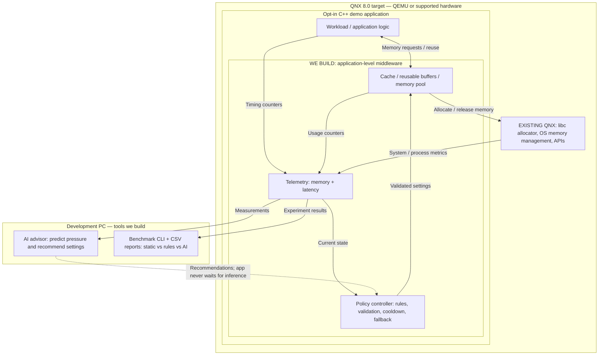

# QNX Control Center

Start the visual dashboard from the project root with PowerShell: `powershell -ExecutionPolicy Bypass -File .\menu.ps1`

To choose between the dashboard and its compiled versions with the same layout (Ratatui and FTXUI), which are built automatically when needed, run `powershell -ExecutionPolicy Bypass -File .\menu-opciones.ps1`.

Setup, guest and host memory telemetry, QEMU/VirtualBox settings, keyboard controls and building the alternative interfaces are documented in [menus/README.md](menus/README.md).

## Repository layout

```text
src/                         QNX target programs (one executable per .cpp)
  probes/memory_probe.cpp    Interactive allocation and memory inspection
  workloads/                Repeatable memory workloads: workload, fm, ramp, step
  examples/                 Hello World and interactive input examples
menus/                      Windows host dashboard and compiled front ends
  ftxui/
    src/                    C++ front-end implementation
    include/                C++ front-end headers
    CMakeLists.txt
  ratatui/src/               Rust front-end implementation
scripts/                    QNX build and VM launch scripts
docs/                       Project planning documents
config/                     Saved configuration assets
menu.ps1                    Main dashboard entry point
menu-opciones.ps1           Interface selector entry point
```

The dashboard discovers runnable QNX programs recursively under `src/`.
The Windows front ends stay under `menus/` so they are not offered as QNX
programs. Headers live with their owning component; there are no shared QNX
headers yet, so a top-level `include/` is not needed. The `src/examples/`
programs are manual examples, not an automated test suite.

Run a target program through the dashboard from the repository root:

```powershell
.\menu.ps1 -Run src\probes\memory_probe.cpp
.\menu.ps1 -Run src\workloads\memory_workload.cpp
```

For the standalone workload VM image, use
`.\scripts\run-memory-workload.cmd` (or add `--build-only` to skip QEMU).
This script expects `qnx800/` and `qnx-hello-vm/` alongside this repository.
Generated builds and recordings remain in the ignored `.build/`,
`menus/bin/`, and `measurements/` directories. Local dashboard settings remain
in the ignored root `qnx.local.json`. `config/imgui.ini` preserves an existing
ImGui layout; the current dashboard front ends do not load it.

## Sprint 3, Step 1: reproducible workload

`src/workloads/memory_workload.cpp` now generates seeded requests and runs a
single-threaded allocate/fill/free baseline. Defaults: seed 42, 1,000 requests,
64 keys, 65,536 bytes per request, and a 10 ms scheduled interval. Eighty percent
of key selections target the first quarter of keys (the remaining selections
cover all keys), providing reuse for the later cache implementation.

From **Windows CMD**, build and start the standalone QNX VM:

```bat
cd /d C:\Users\chaeh\Desktop\Kay\QNX-AI-Adaptive-Memory-Manager
scripts\run-memory-workload.cmd
```

This uses the sibling `qnx800` SDP and `qnx-hello-vm` image, plus QEMU at
`C:\Program Files\qemu\qemu-system-x86_64.exe`. It does not require SSH or
`qnx.local.json`. Wait for the QNX `#` shell prompt, press Enter if startup
messages obscure it, then enter these commands **inside QNX**, one at a time:

```sh
/proc/boot/memory_workload --pattern steady --seed 42 --requests 1000
/proc/boot/memory_workload --pattern burst --seed 42 --requests 1000
/proc/boot/memory_workload --pattern ramp --seed 42 --requests 1000
```

Default runs take roughly 10, 16, and 5.5 seconds respectively, plus any workload
or VM scheduling delay. Each reports its configuration, `sequence_hash`,
completed requests, allocations, result checksum, and elapsed time. Repeat the
same command: its sequence hash and result checksum should match; elapsed time
need not match. `--help` lists all options. Exit QEMU with **Ctrl+A, then X**.

Patterns change the planned arrival spacing, not allocation size:

- `steady`: constant interval.
- `burst`: in each group of 100 requests, the first 20 gaps use interval/10;
  the remaining 80 gaps use interval*2.
- `ramp`: ten phases decrease the interval from 100% to 10%.

The first request is scheduled at time zero. The synchronous baseline waits
until each scheduled time; if processing falls behind, requests run late without
being dropped. This is not a concurrent load generator. `--interval-ms 0`
disables pacing. The baseline allocates one buffer at a time, writes and reads
every byte, then frees it; it does not yet retain a cache or pool.

To inspect reproducible input, run in QNX:

```sh
/proc/boot/memory_workload --seed 42 --requests 20 --trace-only
```

CSV columns are `request_index,key,bytes,scheduled_us`; indices are zero-based,
and `scheduled_us` is the planned offset from the start, not measured latency.
`--trace-only` does not execute the workload. `--trace` executes it and also
prints the CSV. Summaries go to stderr in both modes. To save a trace in QNX:

```sh
/proc/boot/memory_workload --requests 20 --trace-only > /tmp/requests.csv
cat /tmp/requests.csv
```

That file is inside the guest. The standalone VM uses `-snapshot`, so guest
files do not persist after QEMU exits. Trace printing affects execution time;
use runs without `--trace` for comparisons. Runtime statistics and the separate
metrics CSV are described in Step 2 below.

If a running SSH-enabled VM is already configured in `qnx.local.json`, this
alternative **Windows CMD** command builds, uploads, and runs the workload:

```bat
powershell -NoProfile -ExecutionPolicy Bypass -File .\menu.ps1 -Run src\workloads\memory_workload.cpp -RunArgs "--pattern burst --seed 42 --requests 1000"
```

`-RunArgs` accepts simple space-separated tokens, not shell operators, quoted
paths, or redirection; it is supported for direct `-Run`, not `-Prepare`.

For automated verification, run `python scripts\test-memory-workload.py` with
Python 3.10+ on Windows. It compiles with warnings as errors, boots a temporary
QNX test image in headless QEMU, and checks 48 cases covering deterministic
replay, schedules, baseline results, telemetry CSV, reference percentiles,
interruption, and invalid arguments. Build products and the guest log are under
`.build/workload-tests/`.

## Sprint 3, Step 2: runtime telemetry and host CSV

Prerequisite: QNX is running, `qnx.local.json` contains its SSH host/user/port,
and SSH key authentication works without a password prompt. Keep the existing
VM open. This command builds and uploads the current workload, runs it, and
saves a unique CSV directly to the Windows `measurements/` directory:

```powershell
cd "C:\Users\chaeh\Desktop\Kay\QNX-AI-Adaptive-Memory-Manager"
powershell -NoProfile -ExecutionPolicy Bypass -File .\scripts\measure-workload.ps1
```

The same `powershell ...` command works from CMD after changing to the project
directory with `cd /d`. To choose another workload or sample grouping:

```powershell
powershell -NoProfile -ExecutionPolicy Bypass -File .\scripts\measure-workload.ps1 -Pattern burst -Requests 1000 -Seed 42 -SampleEvery 100
```

Other parameters are `-Keys`, `-Bytes`, and `-IntervalMs`. The script prints
`Saved workload metrics: <absolute path>` only after successful execution and
CSV validation. Interrupted/failed runs retain `.csv.partial` output rather
than being presented as successful results. SSH/runtime diagnostics are saved
under `.build/<run-id>.stderr.log`. If the configured SDP script is missing,
the runner checks the sibling `qnx800/qnxsdp-env.bat` installation.

Dashboard program 7 also prints a human-readable p99/throughput/buffer summary
after completion. Its `G` key continues to record the separate system-memory
CSV; it does not activate the new workload CSV. For direct execution in QNX:

```sh
/proc/boot/memory_workload --metrics-csv
```

`--metrics-csv` prints only the telemetry CSV to stdout; diagnostic summaries
go to stderr. `--trace` and `--trace-only` cannot be combined with it.
`--run-id` accepts 1-64 ASCII letters, digits, underscores, or hyphens. The host
runner assigns a UUID-based ID automatically. Direct QNX runs default to an ID
made from the guest wall-clock nanoseconds and PID; a caller can supply an ID
when coordinating records across VM restarts.

### CSV schema version 3 and measurement definitions

Step 3 introduced actual allocator/pool counters and teardown accounting in
version 2. Step 4 upgrades new exports to version 3 with cache configuration,
occupancy, eviction/bypass counts, and measured cache hits/misses. Existing
version 1/2 files are unchanged; readers must check `schema_version`.

Each file contains `window` rows (100 attempted requests each by default, with
a possibly shorter final window) and one `summary` row. Rows are emitted after
execution, so CSV serialization and SSH transfer are outside measured time.
Windows are request-count groups, not fixed time intervals; they become
available at the end of the run rather than streaming live.

| Fields | Meaning |
| --- | --- |
| `schema_version`, `run_id`, `row_type`, `status` | Version, run identity, window/summary, and complete/interrupted/allocation_failed |
| `mode`, `pattern`, `seed`, `configured_requests`, `keys`, `block_bytes`, `interval_ms`, `sample_every` | Reproduction settings; mode is baseline, pool, or cache |
| `window_index`, `start_ns`, `end_ns` | Zero-based window index (summary uses 0), monotonic offsets from run start in nanoseconds |
| `attempted`, `completed`, `allocation_calls`, `allocations`, `frees`, `allocation_failures` | Requests attempted/completed and actual payload allocator calls/successes/frees/failures within this row; summary covers the whole run. Pool acquire/release is not a malloc/free call |
| `allocated_bytes` | Sum of successfully requested payload bytes; cumulative allocation volume, not resident RAM |
| `live_buffer_bytes`, `peak_live_buffer_bytes`, `retained_buffer_bytes` | Payload bytes still in use at row boundary, maximum simultaneous live payload in this row, and idle payload retained for reuse |
| `measurement_storage_bytes` | Reserved sample-vector backing storage; excludes statistics scratch vectors, allocator overhead, and other runtime memory |
| `elapsed_seconds`, `throughput_rps` | Observed duration including pacing and in-loop measurement overhead; completed / duration |
| `latency_p50_us`, `latency_p95_us`, `latency_p99_us`, `latency_max_us` | Successful request service time in microseconds: baseline allocate/compute/free; pool acquire/compute/release; cache lookup plus any miss processing. Excludes pacing and request generation |
| `start_lateness_p99_us` | Successful request start minus scheduled start, clamped at zero; separate from service latency |
| `cache_hits`, `cache_misses` | Measured per row in cache mode; empty (not applicable) in baseline/pool modes |
| `sequence_hash`, `result_checksum` | Present on the summary only; allow input/result comparison across repeated runs |
| `pool_blocks`, `pool_capacity_bytes`, `pool_metadata_bytes` | Configured maximum total pool blocks, payload capacity, and slot bookkeeping bytes; zero in baseline mode |
| `pool_hits`, `pool_misses`, `pool_exhaustions`, `invalid_releases` | Idle-buffer reuses, acquires without an idle buffer, requests rejected at capacity, and rejected pointer returns. A miss may allocate, fail allocation, or exhaust capacity |
| `request_failures`, `peak_owned_buffer_bytes` | Failed requests (including exhaustion), and peak live + retained payload bytes within the row |
| `cleanup_frees`, `post_cleanup_owned_bytes` | Summary-only teardown frees and remaining owned payload bytes after cleanup; blank in window rows |
| `cache_capacity_bytes`, `cache_effective_capacity_bytes` | Configured cache payload budget, and usable budget after rounding down to whole blocks and applying the pool block cap |
| `cache_bytes`, `cache_entries` | Cached payload bytes and entry count at the row boundary; these bytes are a subset of `live_buffer_bytes`, not additional memory |
| `cache_evictions`, `cache_bypasses`, `cache_metadata_bytes` | LRU removals, requests computed without caching because no block fits, and cache slot bookkeeping storage |

Percentiles use nearest rank: sorted observation at `ceil(p * N)`, counting
from 1. Summary p99 is computed from all successful requests, never averaged
from window p99 values. When no requests succeed, latency fields are empty.
Window durations span the previous window's last completion to the current
window's last completion; the first starts at zero. Overall duration additionally
includes the final loop bookkeeping, so it can slightly exceed summed windows.

The baseline owns one payload buffer at a time. At completion its live and
retained payload bytes are zero, while peak live payload equals `block_bytes`.
These are application-owned counters, **not process RSS, libc heap size, or
QNX total RAM**. Use the dashboard guest/host metrics for those separate views.
Allocation counts exclude measurement and standard-library allocations.

All non-trace-only runs collect timing samples, including the default human
summary mode. Storage grows with configured requests (currently one Sample
struct per request), and sorting uses additional scratch memory after the run.
Measurement overhead is therefore part of the instrumented baseline; this is
not a zero-overhead profiler. `--trace` additionally includes stdout tracing in
overall elapsed time, so do not compare its throughput against non-traced runs.
SIGINT/SIGTERM stop after the current request and output partial statistics with
exit code 130; a hard kill or lost transport may prevent any CSV from arriving.

## Sprint 3, Step 3: bounded buffer pool

`src/workloads/buffer_pool.hpp` provides a single-threaded fixed-block pool.
`acquire()` lazily allocates a payload block or reuses an idle block;
`release()` returns it to the pool without calling free. The block limit covers
both checked-out and idle blocks. The pool never falls back to an unbounded
allocation: at capacity, acquire returns null and increments `pool_exhaustions`.
Allocator failure also returns null, but increments `allocation_failures`.
Invalid configuration or metadata allocation failure leaves `valid()` false;
the workload checks that before starting. Payload and metadata are accounted
separately. No payload buffers are preallocated.

In Windows PowerShell, with the existing QNX VM and SSH connection running:

```powershell
cd "C:\Users\chaeh\Desktop\Kay\QNX-AI-Adaptive-Memory-Manager"
powershell -NoProfile -ExecutionPolicy Bypass -File .\scripts\measure-workload.ps1 -Mode baseline -Requests 1000
powershell -NoProfile -ExecutionPolicy Bypass -File .\scripts\measure-workload.ps1 -Mode pool -PoolBlocks 8 -Requests 1000
```

Both commands use `menu.ps1` to build, upload, run, and save separate CSVs.
For the same pattern/seed/keys/size/request count/interval, completed runs must
have identical `sequence_hash` and `result_checksum` in both modes. The pool
reuses storage, not computed results: every request still writes and reads the
whole buffer. Cache hit/miss fields remain empty in baseline/pool modes.

The current workload uses only one buffer at a time. For 1,000 successful
requests with default 65,536-byte blocks, expect:

| Metric | baseline | pool |
| --- | --- | --- |
| Actual payload allocations | 1,000 | 1 |
| Actual payload frees during requests | 1,000 | 0 |
| Pool hits / misses | 0 / 0 | 999 / 1 |
| Live payload after last request | 0 | 0 |
| Retained payload before teardown | 0 | 65,536 bytes |
| Teardown frees / remaining owned payload | 0 / 0 | 1 / 0 |

`-PoolBlocks` (1-4096, default 8) controls the cap, not the amount allocated.
Values above 1 do not change this serial workload's working set; simultaneous
leases, exhaustion, and foreign/double/null returns are tested by the pool unit
test. This step does not claim that pool mode reduces RSS or improves p99: it
trades retained storage for fewer allocator calls, and timing must be compared
using actual repeated runs.

Pointers belong to the pool, must not be freed by callers, and must be returned
exactly once. A returned pointer is invalid for the caller even if a later
acquire reuses the same address; raw pointers do not detect stale aliases after
reacquisition. Buffers retain old contents until overwritten. All clients must
stop using pointers before `clear()` or destruction. Cleanup releases every
owned block (including outstanding leases) and is idempotent. The workload
explicitly clears the pool after timing ends and reports cleanup separately;
normal and interrupted runs leave no payload blocks owned by the pool.

Dashboard program 7 retains baseline as its default for reproducibility. To
run pool mode directly through `menu.ps1`:

```powershell
powershell -NoProfile -ExecutionPolicy Bypass -File .\menu.ps1 -Run src\workloads\memory_workload.cpp -RunArgs "--mode pool --pool-blocks 8" -MetricsCsv
```

The QNX test suite includes pool capacity/reuse, injected allocator failure,
invalid releases, explicit/destructor cleanup, interrupted pool runs, and
baseline/pool output equivalence on steady, burst, and ramp workloads.

## Sprint 3, Step 4: byte-bounded LRU result cache

`src/workloads/bounded_cache.hpp` adds a single-threaded cache that owns its
buffer pool. A cache entry holds one complete fixed-size computed payload, its
key, and its result checksum. A hit refreshes the entry's LRU position and
returns the stored checksum without filling or scanning the payload again.
A miss acquires a pool block, computes the same payload/result as baseline,
and stores it. Keys must identify immutable content for this cache's configured
block size; this prototype has no TTL, invalidation API, or concurrent access.

In Windows PowerShell, with the QNX VM/SSH setup still running:

```powershell
cd "C:\Users\chaeh\Desktop\Kay\QNX-AI-Adaptive-Memory-Manager"
powershell -ExecutionPolicy Bypass -File .\scripts\measure-workload.ps1 -Mode cache -CacheBytes 524288 -PoolBlocks 8
```

For an easy hit/miss check, send 20 requests for the same key:

```powershell
powershell -ExecutionPolicy Bypass -File .\scripts\measure-workload.ps1 -Mode cache -Requests 20 -Keys 1 -CacheBytes 65536 -IntervalMs 0
```

Expect one miss, 19 hits, one payload allocation, and zero owned payload bytes
after cleanup. To compare timings/results, use baseline/pool/cache with the
same pattern, seed, requests, keys, bytes, and interval. Completed runs must
have the same sequence hash and result checksum. Performance improvements are
not guaranteed; this demo's cached result is a checksum, so a cache hit does
not copy the full payload to a caller.

Direct `menu.ps1` equivalent:

```powershell
powershell -ExecutionPolicy Bypass -File .\menu.ps1 -Run src\workloads\memory_workload.cpp -RunArgs "--mode cache --cache-bytes 524288 --pool-blocks 8" -MetricsCsv
```

`-CacheBytes` / `--cache-bytes` defaults to 524,288 and accepts 0 through
4,294,967,295 bytes. The effective number of entries is
`min(pool_blocks, floor(cache_bytes / block_bytes))`. When full, the least
recently used entry is removed **before** acquiring its replacement, returning
the old buffer to the pool. This avoids needing a temporary block beyond the
pool cap. Eviction does not call free: the returned block can be reused.

A budget of zero or less than one block disables retention of results while
keeping requests functional: each is counted as a miss and bypass, computed
using the pool, and its buffer returned. That idle pool buffer still uses
memory, so a zero cache budget does not mean zero application RAM. The byte
budget covers cached payload only; cache/pool metadata and telemetry storage
are separately reported and are not included in that budget.

During cache mode, pool `live_buffer_bytes` includes buffers leased to cache
entries; `retained_buffer_bytes` means idle buffers held by the pool. Do not add
`cache_bytes` to live bytes, because that would count the same payload twice.
Cleanup releases all cache leases, then frees the pool's blocks. Normal and
interrupted runs report remaining owned payload as zero after this cleanup.

Lookup currently scans a bounded slot array; LRU ordering is maintained by
index links. Metadata is allocated once during initialization, with no new
entry allocations during requests. A compute callback must fill the block,
must not retain its pointer, and must not throw. Allocation failure leaves no
new entry; existing entries remain valid. Cache clear is idempotent and resets
occupancy while preserving diagnostic counters.

Tests cover exact LRU order against an independent Python model, repeated-key
hits without recomputation, byte rounding, pool-limited capacity, zero/tiny
budgets, allocation failure, clear/reuse/destruction, interruption, and
baseline/pool/cache result equivalence across steady/burst/ramp workloads.

## Project and plan

**We are building application-level middleware and developer tools that adapt cache and buffer policies in opt-in QNX 8.0 C++ applications and measure the memory–latency tradeoff.**

# QNX Adaptive Memory Manager

Built for the **QNX Global Hackathon**, with AI recommendations outside the real-time execution path.

**Planned category:** Developer Tooling & Host Tools.

## Existing capabilities vs. our contribution

“Existing” below refers to QNX capabilities, not completed features in this repository.

| Area | Already available in QNX | Our planned contribution |
|---|---|---|
| Memory analysis | Momentics Memory Analysis tracks heap allocations and helps detect leaks and corruption. | Collect workload-specific memory and latency metrics for policy decisions and repeatable experiments. |
| Allocation tuning | `mallopt()` exposes allocator controls, including allocation granularity and trimming thresholds. | Implement an opt-in cache/buffer runtime with explicit capacity controls; select and validate policies for that runtime. |
| Adaptive control | The reviewed QNX documentation establishes analysis and tuning primitives, but does not establish an equivalent complete adaptive workflow. | Connect telemetry, threshold rules, and a trained predictor to bounded policy updates, cooldown, and fallback. |
| Evaluation | QNX provides memory analysis and profiling tools. | Compare static, rule-based, and AI-assisted modes on identical workloads, reporting savings, overhead, and regressions. |

Sources: [QNX memory analysis](https://qnx.com/developers/docs/8.0/com.qnx.doc.ide.userguide/topic/analyze_mem_rsc_usage.html) · [QNX allocator controls](https://qnx.com/developers/docs/8.0/com.qnx.doc.neutrino.lib_ref/topic/m/mallopt.html).

**Differentiation to prove:** better memory–latency tradeoffs for a specific QNX workload through an integrated, reproducible control loop. Adaptive caching already has precedents such as [CacheLib](https://cachelib.org/docs/Cache_Library_User_Guides/pool_rebalance_strategy/); we do not claim a first-of-its-kind allocator or guaranteed AI gains.

## Where our middleware fits

The middleware is a library integrated into our demo application, above existing QNX services. It does not replace the QNX memory manager or automatically optimize unrelated applications.



## Sprint 3, Step 5: validate and replay recordings

`scripts/workload_data.py` validates workload CSV schemas 1, 2, and 3 using
Python's standard library. `scripts/workload-data.ps1` is the PowerShell launcher.
Run these commands from the repository directory:

```powershell
powershell -ExecutionPolicy Bypass -File .\scripts\workload-data.ps1 -Action Validate
powershell -ExecutionPolicy Bypass -File .\scripts\workload-data.ps1 -Action Replay -Latest
```

Validation defaults to `measurements/workload-*.csv`; dashboard recordings and
`.partial` files are excluded. Use `-InputPath <file.csv>` to select a file.
`-Latest` explicitly selects the most recently modified workload CSV.
Validation checks columns, types, finite values, window order/timestamps,
configuration consistency, allocation/ownership/capacity accounting, cleanup,
and summary totals. Duplicate run IDs across a validation batch are rejected.
Errors return a nonzero exit code and include the affected file, plus the line
number for row-level errors. Missing metrics remain missing, rather than zero.

Replay validates the entire recording before emitting JSON Lines. It emits
measurement windows in recorded order; it does **not** rerun the QNX workload,
reconstruct individual requests, or reproduce memory allocations. Each event
includes its source path and typed original record. Empty CSV values become
JSON `null`. Summary records are excluded unless `-IncludeSummary` is specified.
Speed 0 (default) emits immediately; speed 1 follows recorded window end times;
speed 10 runs ten times faster. Stop timed replay with Ctrl+C.

```powershell
powershell -ExecutionPolicy Bypass -File .\scripts\workload-data.ps1 -Action Replay -Latest -Speed 10
powershell -ExecutionPolicy Bypass -File .\scripts\workload-data.ps1 -Action Replay -Latest -IncludeSummary -OutputPath .\measurements\replay.jsonl
```

An existing output file is never overwritten. Interrupted replay may leave a
partial JSONL file. Incomplete runs require `-AllowIncomplete` to inspect;
even then, a valid final summary is required. Validation cannot verify the
original request sequence/checksum or percentile samples from aggregates alone.

Use an installed Python 3 interpreter, `-PythonExe <path-to-python.exe>`, or
the `QNX_PYTHON` environment variable. For a local managed runtime, its absolute
interpreter path can be stored in ignored `.build/python-runtime.txt`. That
machine-specific setting is not committed. No third-party Python packages,
SSH connection, or running QNX VM are needed for validation/replay.
`menu.ps1` remains the target build/run and dashboard entry point; this step
processes its saved recordings on the host.

Host tests: `python -m unittest discover -s tests -p test_workload_data.py -v`.

## Sprint 3, Step 6: offline features, training, and held-out evaluation

Run the whole pipeline in **Windows PowerShell**, from this repository:

```powershell
powershell -ExecutionPolicy Bypass -File .\scripts\train-workload.ps1
```

This reads `measurements/workload-*.csv`, validates every input with Step 5,
extracts features, trains a small ridge regression model, and evaluates it on
held-out workload groups. It uses only Python's standard library and the same
interpreter selection as `workload-data.ps1` (`-PythonExe`, `QNX_PYTHON`, local
`.build/python-runtime.txt`, or installed Python). QNX and SSH are not required.
`menu.ps1` still builds/runs workloads and collects recordings; training runs
separately on the host and does not apply memory policies.

Each invocation creates a new `measurements/ai/train-<id>/` directory. The
printed `output_dir` identifies it. Outputs are:

| File | Contents |
|---|---|
| `manifest.json` | Source paths and SHA-256 hashes, run/group IDs, schema, split, usable and skipped pair counts |
| `features.jsonl` | Current-window features, next-window labels, timestamps, run IDs and train/test membership |
| `model.json` | Versioned feature schema, training-only preprocessing, coefficients and training provenance |
| `report.json` | Held-out MAE/RMSE, per-run results, macro run MAE, baseline comparisons and limitations |
| `predictions.jsonl` | Held-out predictions alongside actual labels and persistence predictions |

The two targets are the **next full measurement window's peak owned payload
bytes** and **service p99 latency in microseconds**. Payload means application
buffers/cache, not QNX RAM or process RSS. Schema 1 baseline recordings use
peak live payload as peak owned payload; schemas 2/3 have the explicit counter.
The horizon is `sample_every` requests, not a fixed number of seconds. Short
final windows are excluded from training/evaluation pairs. A run with fewer
than two full windows contributes no labeled examples and is listed in the
manifest. Only complete validated runs are accepted.

Features use only the current completed window: mode, known workload settings,
throughput, p99/lateness, payload counters, allocation rate, capacity and hit
ratios. Summaries, future measurements, run IDs, seeds and checksums are not
model inputs. Missing metrics remain `null` in exported features. The model
uses training-only mean imputation/standardization and explicit missing-value
indicators; all-missing training features use mean 0 and scale 1. Prediction
outputs are clipped to nonnegative values.

Splitting happens **by entire workload group**, never by window. A group is
`(pattern, seed, keys, block_bytes, interval_ms)`: repeated runs and baseline,
pool or cache variants stay together, including runs with different lengths
or sampling intervals. At least two groups with usable pairs are required.
Groups are ordered by a seeded SHA-256 rank; by default 25% (rounded up, with
at least one group left for training) are held out. No parameters are selected
using test results. Keep the split fixed when comparing changes; use fresh
independent runs for a final evaluation after tuning.

The report compares ridge predictions against **persistence** (the current
window's value) and the **training target mean**, with errors in original
bytes/microseconds. Lower is better; equal errors are not counted as a win.
The fit and overall scores weight each example equally; macro run MAE weights
each test run equally. Few examples, constant training targets and modes or
patterns absent from training are explicitly reported. This is an offline
pipeline foundation, not evidence of memory savings or a deployed AI policy.
The initial Step 6 smoke test's six local recordings provided only 30 usable pairs (3 training,
27 held out under the default split); the memory target is constant and the
latency model performed worse than persistence. Collect more seeds, burst/ramp
patterns, block sizes and cache budgets before assessing generalization.

Choose an explicit, **new** output directory for a reproducible invocation:

```powershell
powershell -ExecutionPolicy Bypass -File .\scripts\train-workload.ps1 -OutputDir .\measurements\ai\experiment-01 -Seed 42 -Alpha 1
```

Load its saved model to forecast after the last full window of each recording:

```powershell
powershell -ExecutionPolicy Bypass -File .\scripts\train-workload.ps1 -Action Predict -ModelPath .\measurements\ai\experiment-01\model.json
```

Prediction emits estimates, not accuracy scores. `-Action Evaluate` scores a
saved model against labeled recordings supplied with `-InputPath <file-or-dir>`.
It rejects training run IDs **and** training workload groups, including renamed
runs with the same request conditions. To evaluate genuinely new data, supply
a separate directory of fresh runs with unseen groups. Existing output
directories are never overwritten. Interrupting output writing may leave an
incomplete output directory; rerun to a new directory.

Host tests: `python -m unittest discover -s tests -p "test_workload*.py" -v`.
Tests cover label timing, group separation, training-only preprocessing,
missing values, a closed-form ridge reference, model reload, baseline errors,
and CLI output/failure handling. No new QNX runtime code is introduced here.

## Sprint 3, Step 7: repeated experiments and comparison reports

With the QNX VM running and passwordless SSH configured in `qnx.local.json`,
run this in **Windows PowerShell** from the repository directory:

```powershell
powershell -ExecutionPolicy Bypass -File .\scripts\benchmark-workload.ps1
```

This uses the existing `measure-workload.ps1` → `menu.ps1` build/upload/run path.
It records **baseline, pool and cache** on matched workloads, validates every
CSV, checks request-sequence hashes and result checksums, and generates a
self-contained HTML report with charts. This completes the seven-step Sprint 3
runtime/data foundation; threshold rules, adaptive control and live AI policy
application remain later-sprint work.

Defaults are steady/burst/ramp × seeds 42/43/44 × three measured repeats ×
three modes = **81 measurements**, plus **27 excluded warmup runs**. Each run
uses 200 requests, 64 keys, 4,096-byte payloads, a 1 ms base interval, 20-request
windows, eight pool blocks and a 32,768-byte cache budget. Mode order rotates
between repeats/scenarios. Every invocation starts a fresh process: warmups
exercise the host/guest environment, not a cache that survives into measured
runs. Build/upload overhead is outside workload metrics, but makes the batch
take considerably longer than its request pacing alone.

Inspect the full plan without SSH, compilation or output files:

```powershell
powershell -ExecutionPolicy Bypass -File .\scripts\benchmark-workload.ps1 -Plan
```

For a smaller repeated experiment (12 measured runs plus six warmups):

```powershell
powershell -ExecutionPolicy Bypass -File .\scripts\benchmark-workload.ps1 -Patterns steady -Seeds '142,143' -Repeats 2 -Requests 100 -SampleEvery 10
```

Parameters include `-Patterns 'steady,burst,ramp'`, `-Seeds '142,143,144'`,
`-Repeats`, `-Warmups`, `-Requests`, `-Keys`, `-Bytes`, `-IntervalMs`,
`-SampleEvery`, `-PoolBlocks`, `-CacheBytes`, `-TimeoutSeconds`, `-SkipAI` and
`-OutputDir`. Python 3.9+ is required, with the same `-PythonExe`/`QNX_PYTHON`
selection as Step 6. An explicit output directory must not already exist.
Run one benchmark at a time and avoid simultaneous dashboard program builds;
`menu.ps1` shares a build directory. Keep CPU load/monitoring conditions
consistent when comparing measurements. The dashboard's guest probe itself
adds activity, so use the same probe setting throughout the experiment.

Results go into a new `measurements/benchmarks/batch-<id>/` directory:

| Output | Purpose |
|---|---|
| `experiment.json` | Exact plan/settings, run status/order, timestamps, target config, source hashes, Git state, errors and AI status |
| `raw/` | Copies of measured CSVs only, ready for Step 5/6 tools |
| `warmups/` | Warmup CSVs, excluded from reports and AI training |
| `logs/` | Per-run build/upload/SSH logs, including failed jobs |
| `report.html` | Offline charts and tables; open in a browser |
| `report.json`, `report.csv` | Machine-readable per-scenario/mode statistics and paired changes |
| `ai/` | Step 6 features, model, held-out predictions and evaluation using only this batch's measured runs |

The original files created by `menu.ps1` remain in the top-level `measurements/`
directory, including warmups. For later controlled analysis/training, pass this
batch's `raw/` directory with `-InputPath` rather than selecting all top-level
recordings. Copies retain their run IDs; do not combine originals and copies
in one validation/training input set.

The HTML charts show mean and min/max for allocations, peak owned payload,
per-run p99 latency and throughput. Tables add sample standard deviation,
failure/cleanup counters, cache hit ratio and paired percent changes against
the baseline from the same seed/repeat. Positive change means an increase;
that is worse for allocations/memory/latency and better for throughput.
Zero denominators yield missing changes, not infinity. Missing cache counters
remain missing. The report summarizes **per-run p99 values**; it does not
average window p99s or claim a pooled request-level percentile. Payload bytes
are not RSS/VM RAM, and there is no assumed improvement or significance claim.
Throughput includes configured pacing; service latency excludes scheduled waits.

AI fitting runs after successful measurements, using the Step 6 whole-group
split. If fewer than two groups have adjacent full windows, AI is explicitly
skipped. AI failure returns nonzero while preserving runtime results. The
report links to the separate AI evaluation: this is **baseline/pool/cache**
runtime benchmarking, not a static/rules/AI controller comparison.

The batch fails fast on build/SSH/validation errors or fingerprint mismatch.
It preserves completed recordings and failed-job logs; pending jobs remain
listed. Only fully matched triples enter statistics, so partial results cannot
look like complete comparisons. Ctrl+C stops the active local child process
tree and records interruption; forced terminal closure may leave a `running`
manifest. The per-job timeout includes building and uploading (180 seconds by
default); increase it for deliberately long workloads. Restart in a new output
directory after fixing the failure. No existing recordings are overwritten.

To regenerate reports without QNX, use the exact output directory printed by
your run (this example assumes you chose `-OutputDir .\measurements\benchmarks\my-run`):

```powershell
powershell -ExecutionPolicy Bypass -File .\scripts\benchmark-workload.ps1 -ReportOnly .\measurements\benchmarks\my-run
```

Report-only revalidates saved CSV hashes and comparisons before replacing the
derived reports. It does not rerun workloads or retrain AI. A failed/incomplete
experiment still returns a nonzero exit code. Automated host tests cover plan
rotation, matched workload/result checks, warmup exclusion, paired statistics,
missing values, interrupted/failed batches, integrity checks and AI handoff:

```powershell
python -m unittest discover -s tests -p "test_workload*.py" -v
```

## Step 8: change cache capacity between requests

`runtime::BoundedCache::set_capacity(bytes)` changes the payload budget on an
existing cache. Call it on the owning thread between `get_or_compute()` calls,
never concurrently or from the compute callback. This is a C++ runtime API;
the workload CLI still uses a fixed capacity. Automatic policies and live
telemetry are later steps.

```cpp
runtime::BoundedCache cache(4096, 8, 32768);
if (!cache.valid()) { /* handle initialization failure */ }
// Process requests, then shrink to two blocks without restarting:
if (!cache.set_capacity(8192)) { /* keep the previous policy */ }
// Later grow again; payload blocks are allocated lazily on cache misses:
if (!cache.set_capacity(32768)) { /* keep the previous policy */ }
```

Capacity rounds down to whole blocks and is capped by the constructor's pool
block limit. Read `effective_capacity_bytes()` to obtain the applied limit.
Shrinking keeps the most recently used results and evicts from the LRU tail.
It also calls `BufferPool::trim_idle()`, which actually invokes the configured
deallocator for idle payloads without touching checked-out blocks. Even a
same-capacity call trims idle buffers. Growing preserves existing results and
LRU order and does not preallocate payloads.

Replacement cache metadata is allocated before mutation. Invalid caches,
metadata-size overflow or metadata allocation failure return false without
changing the prior state. Cache metadata is resized; the pool's original
metadata and maximum block count remain fixed. Resize evictions and frees
contribute to the existing cumulative counters. Request peak counters describe
the last request, not the resize operation.

Zero (or less than one block) evicts all results and frees all owned payloads
at the resize boundary. Subsequent requests retain the existing bypass
behavior: compute through one reusable scratch buffer, which can remain idle
until another capacity call or cleanup. Zero cache capacity therefore does not
mean zero application memory. Deallocation reduces application-owned payload,
but does not guarantee that libc immediately returns memory to QNX or lowers RSS.

The QNX test suite exercises shrink/grow/zero/regrow, preserved results and LRU
order, actual deallocator calls, pool caps, allocation failure after growth,
cleanup and 500 requests checked against an independent LRU reference while
resizing. Run `python scripts/test-memory-workload.py` to build with warnings
as errors and execute these tests plus existing workload checks in headless QEMU.

On Windows, use the PowerShell launcher if `python` resolves to a Windows
Store alias (for example, it prints only `Python` and exits):

```powershell
powershell -NoProfile -ExecutionPolicy Bypass -File .\scripts\test-memory-workload.ps1
```

The launcher uses `-PythonExe`, `QNX_PYTHON`, a valid local
`.build/python-runtime.txt`, or a non-Store Python on PATH, in that order. It
checks Python 3.10+ before building/running tests and propagates failures.
A successful run ends with `PASS: 48 QNX cases` and the guest log path.

To inspect saved runtime comparisons and AI prediction errors in the dashboard,
press **A + Enter**. See [AI/cache results](menus/README.md#ai-cache-results-a--enter).

## Core MVP

- **Memory profiling:** Collect system/process memory usage and application counters on QNX.
- **C++ runtime:** Build a bounded cache and reusable buffers or a fixed-block memory pool inside a repeatable demo workload.
- **Policy controller:** Validate changes, enforce limits and cooldown, and fall back safely on invalid input or advisor failure.
- **AI advisor:** Train a lightweight predictor from telemetry to recommend policies on the host or a non-critical background path.
- **CLI and benchmarks:** Compare static, threshold-based, and AI-assisted modes on identical workloads; export CSV results for memory, allocations, p99 latency, throughput, and failures.

Report measured tradeoffs, including regressions or cases where AI does not outperform simple rules. Performance improvements are goals, not demonstrated results.

## Extensions after the MVP

- Native QNX message-passing IPC, a live dashboard, and hot policy reload.
- Additional workloads and a reproducible tutorial.

Application-level optimizations require explicit integration. OS image slimming, kernel changes, DDK drivers, and control of arbitrary third-party processes are outside this MVP. This prototype does not claim hard real-time guarantees.

If the schedule slips, cut the dashboard, advanced AI, then multi-process IPC; preserve QNX execution, the controllable runtime, and reproducible comparisons.

## Development plan

Target **QNX 8.0 on QEMU**, using **QNX SDP 8.0**. Validate the build host and target setup first, including compatibility with the team's Apple Silicon Mac. Exact build/run commands will be added once verified.

Each week has two 3-day sprints and one shared review/buffer day. All dates are in **2026**.

### Shared milestones

| Sprint | Dates | Focus | Completion goal |
|---|---|---|---|
| 1 | Nov 14–16 | Learn QNX basics; set up SDP and QEMU; compile Hello World | Hello World running on QNX, with a saved log |
| 2 | Nov 17–19 | Collect memory metrics; create a repeatable demo workload | Baseline RAM, latency, and throughput report |
| 3 | Nov 21–23 | Implement bounded cache and buffer reuse/pool; measure static vs manual tuning | Tested C++ runtime and initial memory/latency comparison |
| 4 | Nov 24–26 | Add policy validation, threshold rules, hysteresis, cooldown, and fallback | Static vs rule-based demo on QNX |
| 5 | Nov 28–30 | Train a lightweight predictor; validate on separate runs; connect recommendations | AI advisor compared with rules, outside the critical path |
| 6 | Dec 1–3 | Integrate telemetry, runtime, controller, advisor, and CLI; verify reproduction steps | All three modes running on QNX with CSV output; **feature freeze on Dec 3** |
| 7 | Dec 5–7 | Repeat three-mode benchmarks on steady/burst/ramp/mixed loads; test invalid policies and disconnection | Final results, charts, and known limitations |
| 8 | Dec 8–10 | Finish README, license, presentation, and demo video | Submission package ready; public video under 3 minutes |

### Two-person ownership

**Start together (Nov 14–19), then split by specialty.** Both developers establish the QNX environment, minimal workload, telemetry, and interface examples before independent implementation begins.

- **A — C++ middleware / target experiments:** Own cache/buffer management, policy validation and fallback, QNX experiment execution, runtime reliability, build/run documentation, and demo recording.
- **B — AI / host analysis:** Own data preparation, feature design, model training and evaluation, policy recommendations, host-side experiment analysis, and AI/results presentation material. AI is B's core engineering responsibility, not an optional side assignment.
- **Shared:** Interface design, integration, benchmark methodology, result verification, slides, video, and rehearsal. Rebalance supporting tasks at each review to protect B's AI work and avoid overloading A with runtime debugging.

| Sprint / dates | A — middleware and target | B — AI and host tools | Shared completion goal |
|---|---|---|---|
| 1 · Nov 14–16 | Together: QNX setup, boot, and Hello World | Together: same setup, commands, and target evidence | Both can build and run Hello World |
| 2 · Nov 17–19 | Together: minimal workload, telemetry, and baseline run | Together: CSV reader, baseline plot, and interface examples | Working baseline; recorded QNX data, example policies, and agreed formats |
| 3 · Nov 21–23 | Implement bounded cache and buffer reuse/pool; test and export new runs | Build data validation, replay, feature extraction, and training/evaluation pipeline using baseline recordings | Runtime prototype and independently runnable AI pipeline |
| 4 · Nov 24–26 | Add threshold rules, bounds, hysteresis, cooldown, and fallback; test with scripted policies | Develop a first predictor and policy-output adapter; compare offline with threshold rules on available recordings | Rule-based QNX demo and compatible advisor output |
| 5 · Nov 28–30 | Connect advisor files; test stale/invalid recommendations and disconnection; automate QNX runs | Train/refine on new runs; evaluate held-out runs; compare prediction quality and policy outcomes | End-to-end AI demo outside the critical path; initial three-mode comparison |
| 6 · Dec 1–3 | Stabilize runtime and target runner; verify reproduction commands; draft architecture explanation | Stabilize advisor and host reports; document model/data pipeline; draft AI explanation | Integrated static/rules/AI MVP; **feature freeze on Dec 3** |
| 7 · Dec 5–7 | Execute repeated three-mode QNX benchmarks and fault tests; analyze runtime overhead and failures | Analyze memory/latency tradeoffs, prediction errors, and variation; finalize result charts | Jointly verified results and limitations; each owns their analysis section |
| 8 · Dec 8–10 | Finish setup/runtime docs and architecture slides; record QNX demo; assemble video | Finish AI/results docs and slides; prepare chart explanations, narration, and submission summary | Joint slide/script review, video check, and rehearsal; submission package ready |

**Dec 12–14:** Verify public links and submit. **Official deadline: Dec 15, 11:00 a.m. PST.**

Sprint progress map: [QNX Sprint Progress Map](docs/QNX_Sprint_Progress_Map.pdf).

[Hackathon](https://qnx.devpost.com/) · [Rules](https://qnx.devpost.com/rules) · [QNX Everywhere](https://qnx.software/en/developers/get-started/qnx-everywhere)
